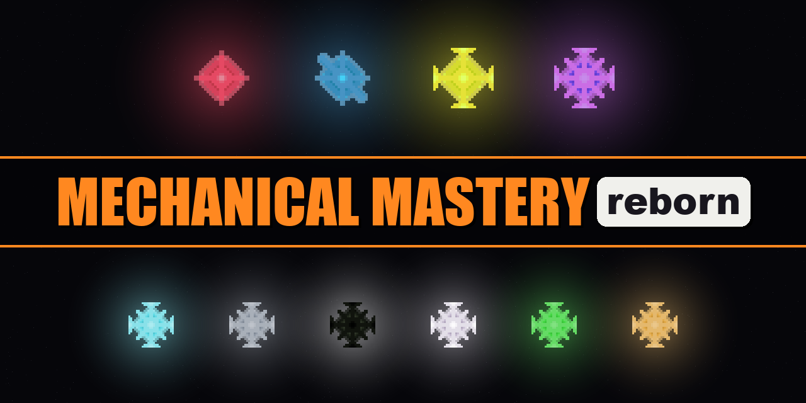

# Mechanical Mastery Reborn (26.1.2)

This is Mechanical Mastery Reborn (MMR), the sequel to my 2024 Mechanical Mastery Plus (MMP), itself a fork of AmmoniumX’s Mechanical Mastery. MMP ended with the creation of a sentient factory, C.O.D., which never stopped making Mechanical Essences, until there was nothing else left.

In MMR your goal is to stop C.O.D. and restore the world’s balance. You break its essences down again: whole machines from the very first one, then intermediates, and finally raw resources. You use what comes out to build production lines for four new Transmuted Essences.

For the factories I picked the -works, a suite of tech mods I make, designed around automation: Craftworks, Beltworks, Pipeworks, Wireworks, Fieldworks, Groundworks, Voidworks and Gearworks. They are made to work with vanilla mechanics and other mods alike, the challenges’ mods included, so every chain can be automated.

The pack has no quest book. Instead, every player starts with the Manual, a GuideME book with 3D scenes that explains how to build the pack’s machines and how each challenge is played. Hold its key over a block or essence to open its page.

You take on four challenges in any order you like, each built around a different mod: Money (AdminShop), Life (Neo Vitae), Protection (Gateways to Eternity) and Energy (Theurgy). Each one comes with a handicap that hinders its production line. Each challenge you win stops C.O.D. making one tier of essence, and once all four are won, the last chapter asks for Quintessence, the one essence that can shut C.O.D. down for good.

C.O.D. will not let you do that without a fight, though...

## For developers

The 26.1.2 pack line, on NeoForge: a skyblock where each team starts on its own island beside C.O.D. and its endless Advanced essence. Its terms are in `GLOSSARY.md`, its decisions in `docs/adr/`, the spec in #163.

### What is here

- The pack: a [packwiz](https://packwiz.infra.link) manifest, `pack.toml`, `index.toml` and a `.pw.toml` per mod in `mods/`, with `config/` and `kubejs/`. Every jar comes from CurseForge. `MODS.md` says what each mod is for.
- The island: Skyblock Builder's config in `config/skyblockbuilder/`, with the team island in `templates/islands/reborn.snbt`: C.O.D., the lab and a tree, and no Recycler, which the team builds from the island's wood and stone. `kubejs/server_scripts/team_of_one.js` gives a player with no team a team, and an island, of their own.
- The recipes: `kubejs/server_scripts/decomposing.js` gives each essence its mix and the Recycler's parts their recipes. What any other item recycles into the companion mod derives from its recipes, and `defaultconfigs/mechanicalmasteryreborn-server.toml` has it read Craftworks' Assembler recipes too (#184).
- `mod/`: the companion mod, a Gradle build of its own (see `mod/AGENTS.md`). `.packwizignore` keeps it, and the repo's other files, out of the pack.

### Working on the pack

From this folder, `mise install` installs the pinned packwiz. Add a mod with `packwiz cf add <slug>` and give it a role in `MODS.md`; `packwiz refresh` on `main` after merging a change to a config or script; a branch leaves `index.toml` and `pack.toml` alone, and `scripts/launch.py` refreshes them for its run (`AGENTS.md`). `packwiz cf export` writes the pack's zip.

### Playing it locally

Once: export the zip, import it into the CurseForge app as a profile named "Mechanical Mastery Reborn", and play it once from CurseForge, so it installs NeoForge.

Then build the companion mod (`sh ./gradlew build` in `mod/`) and run `scripts/launch.py`. It plays that profile offline, into its most recent save, as this checkout stands: the configs and `kubejs/` are copied in, and the companion mod's newest local build goes into `mods/`. The suite stays as the pack has it. `--released` plays the pack's own jars, `--dry-run` says what it would do. It is skillworks' quicklaunch pack launcher with only the companion mod built locally, so it needs skillworks 0.11.7 or later installed, or `QUICKLAUNCH_LAUNCHER` naming its `launch_pack.py`; `QUICKLAUNCH_INSTANCE` names a profile elsewhere.

`scripts/check_offers.py` checks the Shop's Offers against the rules every Offer keeps (#213).

### Releasing

Reborn releases on its own (ADR 0004), with `tools/release.py`, Mechanical Mastery Plus's release tool pointed at Reborn's identity in `tools/release.toml`: its slug, its tag prefix `mmr26.1.2-v`, its CurseForge project and the GitHub repo. Until 0.1.0 the pack is an alpha: its files' display names say "alpha", but every file is uploaded as a Release file, so it reaches the CurseForge app.

Servers install a release from its server pack (ADR 0001 at the repo's root), which ServerStarter runs. A mod servers mustn't install has `side = "client"` in its `.pw.toml`, the only record of which mods are client-only: each server pack tells ServerStarter to ignore every CurseForge project of the manifest and to download the other mods straight from CurseForge's CDN, so `server_files/server-setup-config.yaml` keeps `ignoreProject` empty and lists in `additionalFiles` only files the pack doesn't have. A dedicated server takes its world type from `server.properties`, never from Default World Type, so the start scripts write Skyblock Builder's into a server that has none, and leave an existing one alone.

A change a player will notice adds its line under `## Unreleased` in `CHANGELOG.md`; the mods added, updated and removed are listed by the release itself (`tools/release.py mods`).

1. `tools/release.py cut <version>` on `main` from a clean pack folder: once the tool's tests pass, it writes the version's changelog section, bumps `pack.toml`, exports the client zip into `releases/<version>/`, commits, and tags `mmr26.1.2-v<version>` with the zip's sha256. It pushes and publishes nothing, and a failure before the commit puts every file back.
2. `git push origin HEAD mmr26.1.2-v<version>`.
3. `tools/release.py publish <version>`: the client zip goes to CurseForge, then the server pack (`server_files/` as tagged, pointed at that zip's download link and the tag's NeoForge, and leaving out the tag's client-only mods) as its child file, then both zips to the tag's GitHub release. The release record beside the zip keeps what each site has, so after a failure, fix it and publish again. `--dry-run` shows what it would send, `--site` sends to one site, and `--client-file-id` stands in for a lost record. The CurseForge token comes from 1Password through `tools/publish.env`.

`mise run test` runs the release tool's tests.
