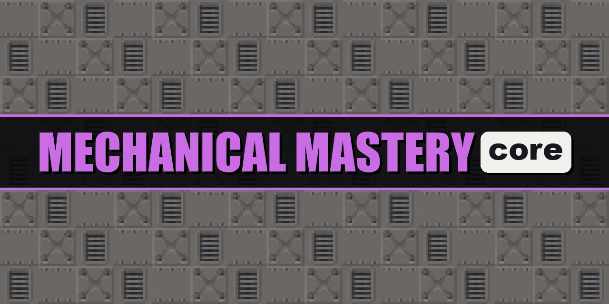

# Mechanical Mastery Reborn Core

The companion mod of the Mechanical Mastery Reborn modpack: C.O.D., its essences and the lab.

## For developers

The mod's build, tests and releases: `AGENTS.md`. It lives in Mechanical Mastery Reborn's folder of the Mechanical Mastery monorepo, and the pack takes it as a released jar.
